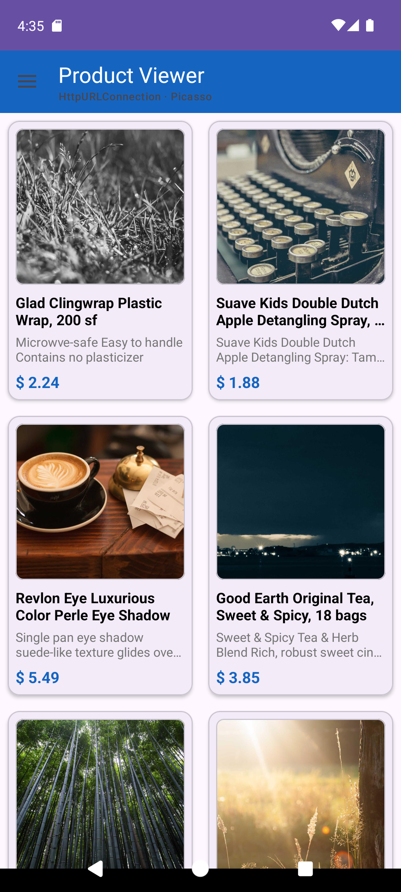
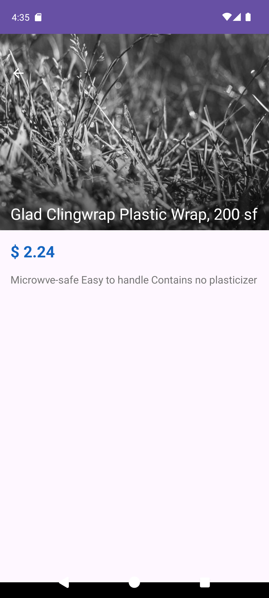
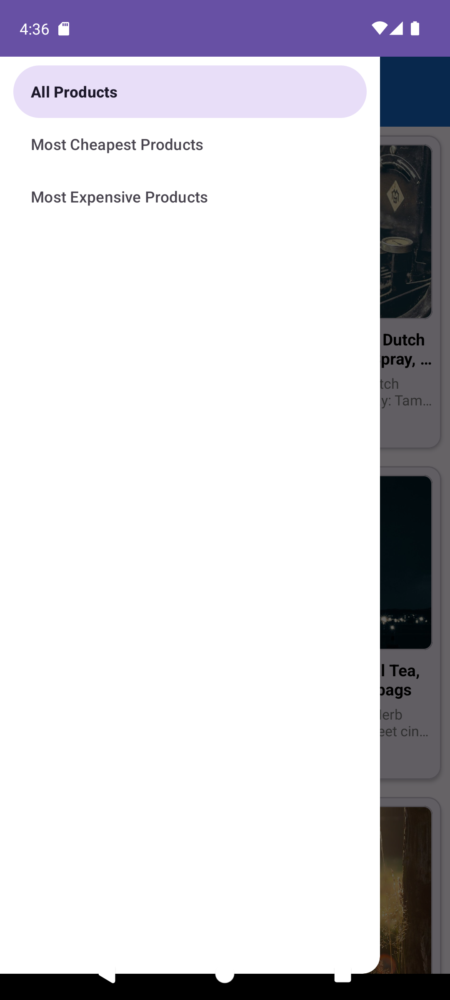
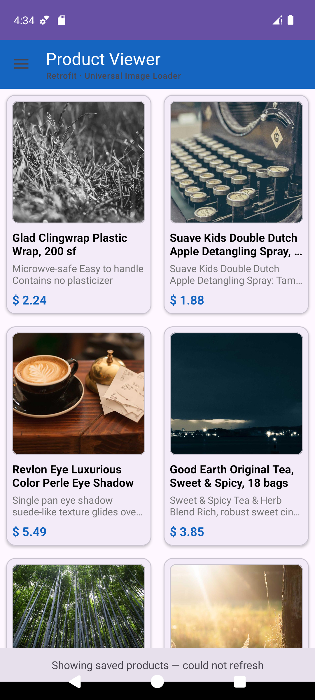

# Product Viewer

An Android application that reads a product feed, stores it on the device and
shows it in a browsable list — built in Kotlin over five assignments during an
Android traineeship at nWeave, where every feature was delivered as a pull
request and revised in code review before it was merged.

**29 Kotlin files · ~790 lines · 6 pull requests, all reviewed and merged.**

## Screenshots

| Products | Detail | Filters | Offline |
| --- | --- | --- | --- |
|  |  |  |  |

The subtitle under the title names the HTTP client and the image library this
run picked — the app alternates between both pairs on each launch. The last
screenshot is the app with no connection: the products are still there, with a
banner saying they could not be refreshed.

## What it does

- Reads a JSON product feed and shows the products in a two-column grid
- Keeps the products in a local database, so the app works with no connection
- A navigation drawer switches between all products, cheapest first and most
  expensive first
- Tapping a product opens a detail screen with a collapsing toolbar
- Shows skeleton placeholders while loading rather than a spinner, and a
  banner when the list on screen is a saved copy that could not be refreshed

## Architecture

MVVM, with the layers kept apart so each one changes for its own reasons.

```
data/
├── local/     Room: entity, DAO, database, mapper, and the stored settings
├── remote/    two interchangeable HTTP clients + the Retrofit interface
├── model/     the domain model the rest of the app speaks
└── repo/      the single source the UI reads from

di/            Hilt modules that assemble the database and the network

ui/
├── splash/    entry point
├── main/      the drawer and the toolbar
├── products/  the list: fragments, adapter, ViewModel, UI state
├── details/   the detail screen
├── image/     two interchangeable image loaders
└── common/    Data Binding adapters
```

## Decisions worth pointing at

### Two network clients, swapped at runtime

The feed is fetched either through `HttpURLConnection` written by hand or
through Retrofit, and the app alternates between them on each launch. The
repository asks for products; it never learns which client answered.

Writing both is what made the difference between them concrete: the hand
written fetcher opens the connection, reads the stream, parses the JSON and
closes the connection in a `finally`; the Retrofit one is a three line
interface and one call.

### Two image loaders, the same way

Picasso and Universal Image Loader sit behind one `ProductImageLoader`
interface, chosen by Hilt. The adapter calls `load(url, imageView)` and has no
idea which library is underneath.

### Local first, after a review said otherwise

The first version asked the network before it read the database, so with no
connection the screen sat on a loading skeleton while the products were
already on the device. **The reviewer declined that pull request.**

The fix was a rewrite of the data layer onto Room with coroutines and a
`Flow`:

```kotlin
// The screen subscribes once. Every write to the table arrives on its own.
fun getProducts(): Flow<List<Product>> =
    dao.getProducts().map { entities -> entities.map { it.toProduct() } }

// Refreshing is separate, and says whether it reached the feed.
suspend fun refresh(): Boolean { ... }
```

The ViewModel now subscribes to the database once and refreshes in the
background, so stored products are drawn as soon as the query returns and
nothing waits on the network. The change removed 233 lines and added 128.

### Writes that a subscriber cannot catch half-finished

Refreshing upserts the new products and then deletes the ones the feed no
longer carries. Those are two writes, and a `Flow` reports every change — so
without a transaction the screen would redraw once showing a stale row
alongside the new ones, then redraw again:

```kotlin
database.withTransaction {
    dao.upsertAll(products.map { it.toEntity() })
    if (products.isNotEmpty()) dao.deleteNotIn(products.map { it.id })
}
```

### A primary key, so a refresh updates in place

The first version cleared the table and rewrote it on every fetch. The feed
already sends an `id`, so that became the primary key and a refresh upserts
instead — rows keep their identity, and only what actually changed is written.

## Built with

| | |
| --- | --- |
| Language | Kotlin |
| Architecture | MVVM, repository, Hilt for dependency injection |
| Async | Coroutines and Flow |
| Local storage | Room (migrated from hand-written SQLite) |
| Network | Retrofit + Gson, and `HttpURLConnection` |
| Images | Picasso and Universal Image Loader |
| UI | Material Design, RecyclerView, CollapsingToolbar, Data Binding, Navigation Drawer |

## The assignments

| | |
| --- | --- |
| #1 | Material Design — splash, drawer, toolbar, detail screen |
| #2 | Reading a JSON feed from the network |
| #3 | Displaying it in a RecyclerView |
| #4 | Image libraries and moving work off the main thread |
| #5 | Local storage: SQLite first, then rewritten onto Room with coroutines and Flow |

## Running it

Open the project in Android Studio and run it. There is nothing to configure —
the feed is public and there is no API key.
